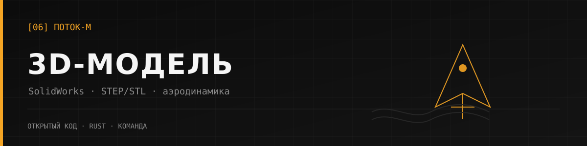

# potok-m-3d

Текстовые входы для 3D/CAD-модели ракеты «Поток-М»: геометрия, массы, требования к экспорту. Сама геометрия в git не лежит.

## Что здесь

- `DESIGN_INPUT.md` — минимальный набор входных данных для расчёта конструкции.
- `AEROTUBE.md` — рабочая гипотеза по аэротрубе, не обязательный этап.
- `cad/`, `aero/` — каталоги под локальные модели и аэроданные; в git только `.gitkeep`.

## Геометрия и статус

Нативные `.SLDPRT`/`.SLDASM` в git не попадают: проприетарный формат, исходники хранятся вне репозитория. Канонический формат обмена для симуляции и CFD — STEP AP214/AP203 и binary STL в миллиметрах плюс массовые характеристики из SolidWorks. Тяжёлые STEP/STL и сборки публикуются в [Releases](https://github.com/rocket-team-m/potok-m-3d/releases), а не в git; на текущий момент релизов нет, поэтому в репозитории доступны только текстовые входы. Имеющаяся геометрия требует сверки с актуальными ТТХ: STEP используется как исходная форма для параметрического пересчёта, а не как истина.

## Аэродинамика

Для траектории нужны таблицы $C_D(M,\alpha)$, $C_m(M,\alpha)$ и $C_{m\delta}$; их готовят из CAD-геометрии в OpenRocket или CFD и передают в `potok-m-sim` как аэрокарточку.

## Репозитории

**Публичные (8):** [.github](https://github.com/rocket-team-m/.github) · [potok-m](https://github.com/rocket-team-m/potok-m) · [potok-m-ai](https://github.com/rocket-team-m/potok-m-ai) · [potok-m-sim](https://github.com/rocket-team-m/potok-m-sim) · [potok-m-protocol](https://github.com/rocket-team-m/potok-m-protocol) · [potok-m-firmware](https://github.com/rocket-team-m/potok-m-firmware) · [potok-m-edge](https://github.com/rocket-team-m/potok-m-edge) · [potok-m-3d](https://github.com/rocket-team-m/potok-m-3d)

**Приватный:** RocketCraft (`potok-m-workbench`) — CAD/CFD/FEA/GUI.

## Лицензия

Собственный код: GPL-3.0-or-later; коммерческая лицензия доступна отдельно (`LICENSE-COMMERCIAL.md`). Third-party компоненты сохраняют свои лицензии.
